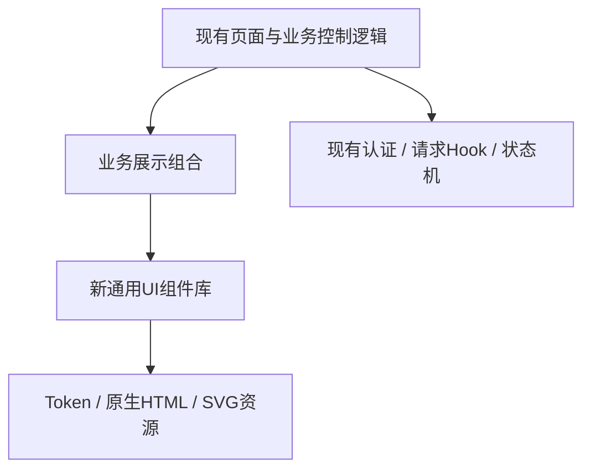

# 家序组件库重置与全界面重做方案

> 历史文档：设计状态与验证结论仅对应文档日期；本次发布仅脱敏，不代表重新执行验收或完成部署。

日期：2026-10-10。版本：2。状态：已按用户最新要求修订，尚未实施。

## 1. 改动目标与基线

本次以**组件库重置与全部界面重做**为主体：重新建立视觉基础、控件、表单、弹窗、导航、数据展示与反馈规范，再迁移全部现有页面。家人应能快速判断家庭状态、找到操作入口、理解设备控制和自动化结果。状态、阶段、进度与规则关系采用可扫读的结构，保留必要文字。

用户已明确限制：重点在组件库，前端架构继续沿用。路由定义、认证与身份代次、请求协调、数据Hook、聊天reducer和服务端业务边界保持现有职责。审查发现的5项工程问题是独立修复线，不因界面重做扩大成整体架构重构。

审查依据：[工程与设计审查](../../frontend-engineering-and-design-audit-2026-10-10.md)。代码基线为 `codex/p1-p2-remediation`，提交 `84b5ebba90964857a4986f1055a2bc1f599aec17`，产品根目录 `仓库根目录`。实施从上述基线建立可写隔离工作树。基线更新时先比对相关接口、权限和测试。

上一轮184个前端测试、27个浏览器用例及相关Go包通过；fixture退出阶段挂起。这些是旧界面的基线结果，不代表重做方案已实现。真实音质、供应商可用性及物理负载仍需单独验收。

## 2. 修订后的范围

原“在现有设计体系内局部改进”方案被本版本替代。全面重做界面与组件库无需重写路由、请求和业务状态。重新设计范围按下表执行：

| 范围 | 本次改动 | 保留的职责 |
| --- | --- | --- |
| 视觉基础 | 重新建立token、排版、间距、圆角、边框、层次、图标尺寸、交互状态与响应式规范 | 暂以家序品牌和浅色绿系为基础，品牌色可由token单点替换 |
| 通用组件库 | 建立统一Button、表单、Dialog、Card、导航呈现、状态、列表、进度等组件及使用文档 | 只处理HTML语义、呈现、焦点和受控交互 |
| 应用外壳 | 重做侧栏、顶栏、移动导航、页面框架与认证界面 | 导航目的地、能力筛选、Route定义、AuthProvider与身份key |
| 全页面 | 全部12个页面及登录、强制改密、加载、无权限、服务异常界面迁入新库 | 页面取数、事件回调、业务判断、URL参数、操作归属 |
| 业务展示 | 重做家庭摘要、设备卡、知识列表、聊天附件、语音、采集和规则关系 | 已校验DTO、现有formatter及明确确认／核对语义 |
| 样式体系 | 新库拥有基础样式，业务局部样式有明确归属，全部迁移后退出旧三份CSS | 同源静态资源与CSP |
| 工程修复／明确增量 | 独立完成R1—R5及单列验收的录音计时增量 | 各自按既有契约验证，不将请求或状态边界迁入UI组件 |

交付分为两个子项目：[组件库与全界面实施计划](../plans/2026-10-10-frontend-visual-plan.md)、[可靠性实施计划](../plans/2026-10-10-frontend-reliability-plan.md)。组件库的详细规范、组件契约和迁移退出标准见[组件库设计规格](2026-10-10-component-library-design.md)。

## 3. 全局约束

- 全面重做组件库与所有现有界面；保留家序品牌、中文信息、现有导航目的地、路由参数与能力边界。
- 使用现有React、TypeScript、Vite、Vitest、Playwright和Go；本轮不新增UI、图表、动画、状态管理依赖。
- 组件库只依赖React、原生HTML和视觉资源，不反向依赖认证、API、请求Hook、业务状态或页面。
- 保留AuthProvider、coordinator、useFamilyQuery、useConsoleAction、chat-state、useVoice的现有职责；仅R1—R5及明确列出的计时增量修改相应业务行为。
- 浏览器只访问同源Console；保留Cookie、CSRF、身份epoch、权限与提议所有者检查。
- 设备动作与自动化安装继续需要明确确认；结果未知时不自动重发写操作；共享继续默认关闭。
- 复用现有业务能力、SafeMarkdown和SVG资产；基础UI以新契约重新建立，不让旧CSS继续主导新组件。
- 状态必须有明确文字；图形与颜色辅助判断。安装、配置、连接、数据新鲜度和实际执行结果分别表达。
- 正文16px、辅助文字至少14px、主要触控目标至少44px；这些字号和触控尺寸属于项目标准。
- 全部迁移页面的普通文字及占位符对比度至少4.5:1；支持200%文字放大，关键内容与操作保持可用。
- 动态进度采用原生progress、语义化HTML及CSS类，保持现有CSP；不引入CDN、内联脚本或模拟波形。
- 按组件族及页面逐批迁移，每批有交互验证和回退点；工程缺陷先补能够失败的回归再修复。

文字对比、颜色冗余和200%放大的依据分别见[W3C对比说明](https://www.w3.org/WAI/WCAG22/Understanding/contrast-minimum.html)、[颜色使用说明](https://www.w3.org/WAI/WCAG22/Understanding/use-of-color.html)和[文字缩放说明](https://www.w3.org/WAI/WCAG22/Understanding/resize-text.html)。这些检查不等同于完整WCAG合规认证。

## 4. 可靠性子项目

### 4.1 请求协调与真实取消

问题：所有Console请求、认证变更与WebSocket握手共用队列，取消未中止底层fetch；长问答会挡住其他页面和退出。

改动边界：保留稳定的Worker URL `/app/assets/console-auth-worker.js` 与名称 `family-console-auth`。协调协议提升至version 2；旧新标签混用时拒绝不兼容连接并提示关闭旧标签后重新打开，不能创建另一个名称绕过身份协调。

Worker职责分为普通请求执行、Cookie变更串行通道、WebSocket握手租约。普通请求不等待其他业务响应；每个请求使用独立AbortController，键为port＋request ID，取消、页面离开、身份失效都真正中止该请求及其身份预检查。身份预检查最长10秒，普通读取15秒，普通业务写入60秒，`/admin/knowledge/query`、`/admin/analyze`、`/admin/wiki/ingest`允许310秒。超时仅表示本地等待结束；已提交业务写入仍可能完成，保持现有未知结果语义。

认证变更开始时关闭新的受保护请求入口，取消旧代次普通请求，等待其他标签移除私人界面后的ACK；ACK截止时间保持5秒。保留发起标签在AuthProvider内先清除身份的行为。检查与发起请求期间再次验证generation，响应返回后再次校验generation。普通请求不得占用Cookie串行通道直到完整响应返回。

为避免拆开队列后出现“预检查是旧账号，真正请求携带新Cookie”的竞态，新增**可选请求前置条件**：Worker对携带expected的受保护HTTP请求设置 `X-Console-Expected-User`，并使用已有 `X-CSRF-Token`传递对应会话令牌。Go middleware在该用户头存在时，对读取也核对用户ID与CSRF；不匹配返回401、`identity_changed`，不进入业务handler。身份检查接口auth/me及公开auth/status不绑定旧身份；业务写入的原Origin与CSRF规则始终保留。未发送新用户头的旧客户端沿用既有规则，以便先部署后端再部署前端。不能把这两个值写入URL、日志或用户可见错误。

Cookie变更请求一旦发起，不因页面cancel或普通超时而提前释放串行通道；必须等其网络响应结算，防止迟到Set-Cookie覆盖新登录。等待超过10秒显示“认证操作仍在等待；当前界面已隐藏私人内容”，不宣称已退出，不接受新登录绕过等待。网络失败进入现有重新核对身份／退出失败路径；不自动重试认证写入。

WebSocket租约只覆盖握手。10秒未打开就关闭socket；连接中关闭须等close事件或标签确实销毁，才能释放租约。不能仅因定时器到期就释放仍可能带旧身份打开的连接。无法证明已关闭时，Cookie屏障失败关闭，给出重新打开页面的入口。已打开连接由现有身份失效处理关闭，不占用整个对话生成期间。

验收：挂起长请求期间其他GET可完成；取消后fetch.signal为aborted；退出不等待长业务响应；旧响应不回填新账号；旧请求不能在新Cookie下进入handler；认证写入及握手仍不越过ACK和租约屏障。

### 4.2 新SID与朗读消息身份

复用现有消息索引契约，不引入新的消息ID体系。`serverSession`在旧SID变为新SID且当前phase为sending时，只保留最后一条正在发送的用户消息，清空旧提议缓存；epoch、revision与pending保持，使当前回复仍能被正常接收。null→首个SID保留首条用户消息；同SID事件幂等。非sending时不接受突发换SID。

ChatPage同步更新URL，内部导航不再次选择会话，不触发多余历史覆盖；取消旧会话录音、播放、语音任务与提议刷新，并清理控制错误。新回复的自动／手动朗读使用新SID中真实索引；旧回复仍能从旧历史访问。旧音频回调不得更新新会话。

验收：达到轮数上限后的新会话只有本轮问答，回复索引为1；首次对话正常；过期epoch/revision事件丢弃；旧历史不被删除；新回答只触发一次自动朗读。

### 4.3 执行中控制提议的结果恢复

新增专门的提议读取逻辑，复用现有GET `/control/proposals/:id`。不改变全站useFamilyQuery的30秒刷新周期。以epoch＋revision＋SID＋proposal ID绑定一个监听周期；可见页面中的executing卡立即GET，前15秒每1秒读取，之后每3秒读取，60秒停止。单卡请求不重叠，全页最多两个并发读取，重复附件复用同一ID结果；终态、页面隐藏、卸载、身份／会话改变均停止。

60秒未获得终态或读取失败时，保留服务端executing状态，另显示“暂未取得最新结果”及“刷新状态”。恢复可见时先GET；只有仍为executing才启动新的有界周期。自动刷新不会POST。用户点击刷新只GET；只有现有unknown的“核对状态”先GET发现服务端仍为unknown，才使用现有只读reconcile POST。两种入口文案区分，全部禁止重复confirm。

| 状态 | 可见反馈 | 允许操作 |
| --- | --- | --- |
| pending | 等待确认／剩余有效时间 | 有权限者确认、取消提议；过期立即禁用确认 |
| executing | 正在执行，无法撤回 | 自动读取，手动刷新状态 |
| succeeded | 已观察到目标状态 | 查看观察时间与负载提示 |
| unknown | 结果尚未确认 | 手动核对；不提供重复执行 |
| failed / cancelled / expired | 明确终态 | 重新表达需求须由用户重新发起 |

验收：历史恢复和丢失确认响应之后读到executing，都能随后展示succeeded或unknown；自动监听只发GET；隐藏页面无轮询，迟到旧结果不覆盖当前会话。

### 4.4 设备状态语义与安全DTO

后端DeviceQueryResult增加可选 `domain`、`device_class`、`unit`；从已授权目标和当前HA state投影，类别复用safeDeviceClass；unit沿用目录的字符串字段，不透传attributes。历史记录缺少字段仍可读取。

抽出已有entityStateLabel语义至纯函数，区域页和聊天卡共用：已知light/switch/fan/input_boolean的on/off为开启／关闭，door/window/opening为打开／关闭，tamper为检测到防拆／未检测到防拆，motion/occupancy/presence为检测到／未检测到。未知类别保留原值；unknown、unavailable、空状态明确表达。旧DTO无domain时仅可从格式有效的entity_id前缀获得domain，不能从名称推断device_class。数值与单位独立展示，React以文本转义。

验收：门磁、防拆、运动、电源开关及未知二值类别含义正确；旧记录兼容；畸形entity_id和元数据降级为原值；无新增私密属性。

### 4.5 成员弹窗与迟到结果

提交时锁定当前弹窗的关闭、Escape、遮罩和切换成员入口，防止一次性临时密码在等待期间被错放或丢失；文案说明“正在等待结果，离开页面不会撤销已提交的操作”。同时增加dialog generation与mounted检查，create、rename、reset只更新发起操作的弹窗和账号代次。路由离开后结果不回填；失败保留当前输入且不自动重试。确认结果呈现后恢复关闭和切换。

验收：同账号迟到改名不关闭另一弹窗，迟到临时密码不显示在其他成员名下；双击只提交一次；身份切换隐藏敏感结果；关闭不能被解释为撤销服务端操作。

## 5. 组件库重置与全页面设计

### 5.1 新组件库成为主交付

目前基础UI以页面JSX加全局CSS组合为主，没有独立基础组件库。`styles.css`、`console.css`与`pages/chat.css`共同定义控件与覆盖规则。本次建立`web/src/ui/`作为视觉与交互的单一来源，并将相关旧规则退出，不能只增加几个状态组件或在CSS末尾继续覆盖。

组件分四层：视觉基础；通用控件和布局；复合反馈与数据展示；业务展示组合。UI层接收已确定的数据、slots和回调，业务层继续拥有网络、权限和业务状态。依赖方向如下：

组件清单、文件归属、公共props、状态覆盖和展示页见[组件库设计规格](2026-10-10-component-library-design.md)。必须先在展示页验证真实组件，再迁移页面；展示页不调用业务API、不创建新的产品路由，不添加Storybook等新运行依赖。

### 5.2 视觉与布局整体重建

以家序绿色为品牌线索，重新设计界面层级：中性背景、白色内容面、清晰描边、有限阴影，品牌色重点用于主操作与选中导航。统一字号、留白、圆角、表单密度、焦点和忙碌反馈，取消装饰性英文眉题及大块欢迎区对主要任务的占位。

新库采用三级token：基础值→语义→组件；完整色板和数值在组件库规格中固定。手机保留现有最多五个主要目的地，桌面保留侧栏；重做它们的布局与外观，菜单内容继续在App按原能力筛选。外壳与聊天交互边界统一采用现有760px，内容网格采用600/1000px；不因CSS变更悄悄改变手机Enter规则。

Card、字段、列表、状态、技术详情和操作栏采用统一视觉语法。关键风险、异常与未知结果始终外露；部署标识和完整时间戳可展开。布局不依赖固定高度裁剪长文字。

### 5.3 全页面迁移矩阵

| 页面／界面 | 新设计重点 | 业务保持项 |
| --- | --- | --- |
| 登录、首次改密及认证等待／失败 | 统一认证框架、品牌、表单、反馈与安全说明 | 密码类型／autocomplete、校验、退出失败处理与私人界面隔离 |
| 外壳、导航、无权限 | 统一侧栏、顶栏、手机导航、PageFrame与EmptyState | Route、目标地址、能力筛选、identity＋epoch key |
| 首页 | 简短欢迎→主入口→异常→概况→最近对话；服务状态分层 | 入口权限、查询口径、草稿跳转与SID |
| 区域列表／区域详情 | 搜索、数量摘要、统一区域／设备卡、筛选、面包屑 | q、areaID、搜索上限、分组与去重口径 |
| 设备详情 | 实体状态大字、类别／单位、归属与诊断分层 | 当前区域范围、membership、负载地点未验证、R4语义 |
| 公开知识 | 搜索与结果列表、来源、正文阅读面 | q/path、公开库边界与SafeMarkdown |
| 管理员私人知识 | 检索、一次问答、来源与导入分区 | 固定personal库、上限、CSRF、单次问答不进入聊天历史 |
| 我的 | 个人资料、家庭入口、安全设置与退出 | 改密校验、代次、会话失效与管理入口权限 |
| 成员管理 | 统一成员行、角色／状态、动作与Dialog | create/rename/reset/temporary、R5代次与临时密码归属 |
| 对话 | 历史列表、消息表面、附件卡、输入区、语音区全面重做 | SID/revision/epoch、IME、滚动、unknown恢复、只读历史 |
| 采集 | 快照→历史→完整采集；真实批次与异常 | 完整成功与checkpoint区别、14天分析只产生建议 |
| 自动化 | 列表状态、何时→条件→动作、版本／证据／授权分层 | 绑定、确认、核对后明确重试、共享revision与旧授权撤销 |
| 助手设置 | 服务选择、模式对比、云端发送提示、部署详情、人格上传 | 草稿、版本冲突、密钥、文件校验与生效时点 |

区域、设备、知识、账号、登录等全部纳入重做，不再仅进行token微调。每页迁移完成后删除其旧基础UI样式消费者。

### 5.4 状态与纯文字依赖的重做标准

| 内容 | 新表达 | 数据约束 |
| --- | --- | --- |
| 服务连接与新鲜度 | 独立状态标签、异常摘要、可展开检查详情 | 配置、安装与连接均不等于实际生成成功 |
| 数量摘要 | Metric＋明确统计名称 | 设备注册项、实体和通道口径不混用；缺值不默认0 |
| 控制提议 | 设备／房间→当前与目标→状态→动作→观察详情 | 有效期、R3刷新、unknown核对、现场负载提示保留 |
| 语音 | 识别和朗读分开；真实录音计时；阶段忙碌反馈 | 60秒停止等待发送、8MiB、自动朗读默认关闭 |
| 采集 | StepSequence＋可信ProgressSummary＋失败入口 | 合法批次才显示进度，0/0不是100%，旧快照不是本轮完成 |
| 自动化 | RuleFlow中文关系结构，技术原文可核对 | 任一触发、全部条件、顺序动作；未知语义不猜有人／无人 |
| 配置 | 分组字段、模式对比、上下文提示、高级详情 | 已配置未验证；保存不发起付费测试；不覆盖草稿 |

聊天与知识正文继续用文本和安全Markdown。图标、步骤与进度解决可扫读问题，不设“图形数量”或“文本占比”指标；验收以用户能否正确理解为准。

### 5.5 首页、聊天与管理页的关键交互

首页：320×740、默认字号、普通名称下，“开启新对话”整体位于底部导航上方的首屏。长名字、较多异常和200%字号允许纵向滚动。服务异常外露，时间和模型名降到详情。同一查询结果向摘要传递，不增加聚合API或额外健康探测。

聊天：桌面历史侧栏与手机历史切换重新呈现；原聊天状态、refs和滚动算法留在ChatPage。输入区保留composition事件、桌面Enter发送／手机Enter换行、语音和unknown期间的禁用策略。SafeMarkdown保留HTML跳过、图片降级与安全链接。ControlCard与VoiceControls消费新UI，仍是业务适配器。

采集：阶段、真实批次、窗口、最近完整成功分层；idle不等于本轮完成。自动化：摘要只来自经验证rule与授权目录，目录不可读取时保留entity_id。助手：文字回答、识别、朗读分别选择模式，云端提示靠近对应操作；地址与路径进高级详情，错误时展开并聚焦。人格下一条回复生效，文字模式新对话生效。

## 6. 八荣八耻作为交付检查

| 原则 | 本次要求 | 证据 |
| --- | --- | --- |
| 查档求证 | 组件消费真实HTML契约，业务摘要与Go字段一致 | 组件契约、交互测试、真实fixture |
| 对齐需求 | 组件库重置与全界面覆盖，保持架构边界 | 本设计、组件库规格、完整迁移矩阵 |
| 请示规则 | UI不推断家庭规则、权限或设备含义 | 未知类别／绑定／unsupported回归 |
| 复用存量 | 复用业务能力与安全资产，统一新UI来源 | 依赖方向检查、无重复数据层 |
| 完备测例 | 组件交互、R1—R5及全部页面状态 | 新增回归、浏览器结果与截图 |
| 恪守规范 | 同源、权限、CSP、字号、对比与焦点 | 安全回归和computed style |
| 坦诚存疑 | unknown/stale/configured/observed分别表达 | 断网、缺值与迟到结果验收 |
| 分步迭代 | 组件族→页面逐批迁移，旧样式有退出标准 | 分任务diff、阶段出口与回退点 |

组件库重置与复用存量不冲突：复用可靠业务能力，基础UI在统一契约下重新建立。不能只凭成品断言开发过程全面合规，交付需保留核对、测试与审阅记录。

## 7. 实施顺序、交付物与回退

| 阶段 | 任务 | 阶段出口 |
| --- | --- | --- |
| A 契约与组件库 | DS1视觉基础、DS2基础控件、DS3表单与Dialog、DS4布局导航、DS5状态数据展示、DS6组件展示与依赖检查 | 核心组件契约及状态矩阵通过，展示页无业务请求 |
| B 外壳与全页面迁移 | M1认证／外壳、M2首页、M3家庭目录、M4知识、M5账号／成员、M6对话、M7采集、M8自动化、M9助手 | 全部现有界面使用新组件，业务归属不改变 |
| C 可靠性修复线 | R1—R5，独立审阅 | 5项缺陷回归通过；作为相应页面最终验收前置项 |
| D 旧样式退出 | Q1消费者清点、旧CSS／兼容层移除 | 关闭旧CSS后全页面仍完整可用 |
| E 整体验收 | Q2组件、权限、响应式、理解任务、fixture清理 | 完整截图、结果、限制与回退说明 |

A与R可以独立推进；M6验收依赖R2/R3/R4，M5成员页验收依赖R5，M8规则摘要复用R4。R1修改App等待状态与认证协议，M1只替换呈现；涉及同一文件时分步整合，不同时覆盖。旧缺陷在独立任务修复，组件迁移不得顺手改写业务Hook。

交付物：新组件库源码、设计token与使用文档、开发专用组件展示页、全部页面新界面、迁移／退出清单、必要回归、桌面与手机关键状态截图、真实测试结果及未验证项。

迁移期间保留受限旧样式兼容层，按页面边界隔离；新组件采用jx命名空间与明确CSS层级，不能被旧全局input/button规则覆盖。每个页面迁移完成后删除其失效旧声明；最终去除styles.css、console.css、pages/chat.css的原导入及无消费者规则，必要聊天专属布局迁到业务局部样式。兼容层必须退出，不能永久保留两套组件。

按组件族／页面提交，回退到该批之前的代码与匹配样式，不添加产品级“旧／新UI切换”或两个身份系统。R1发布先兼容后端再前端，回退先前端再后端；DTO可选字段兼容旧记录。发布静态资源与服务作为完整版本核对。

性能分包仍是可选独立任务：先测加载再决定，不与组件库重置绑定为全站请求或路由重构。

## 8. 最终验收矩阵

| 维度 | 必测情形 | 通过条件 |
| --- | --- | --- |
| 覆盖 | 12个页面及认证／无权限／异常界面 | 迁移矩阵全部完成，使用同一套新组件与token |
| 组件 | 正常、focus、disabled、busy、错误、空值与长文本 | 状态契约完整，按钮type正确，表单关联和Dialog键盘／焦点正确 |
| 依赖 | ui目录静态依赖与展示页请求 | 无auth/API/路由守卫/业务Hook反向依赖，无新增全局store |
| 身份 | 多标签、冻结标签、长请求、登录／退出／改密 | R1通过，无旧内容回填或旧请求作为新账号执行 |
| 会话／语音 | 初始／新SID、历史、IME、上翻、取消与播放受阻 | 既有交互不退化，正确索引，无旧回调或资源泄漏 |
| 控制／语义 | 全状态、迟到回应、旧DTO、未知类别 | 结果可更新，无自动重发confirm，无含义臆测 |
| 表单 | 临时密码、双击、版本冲突、周期读取、上传错误 | 不串对象、不丢草稿、不重复提交、不泄漏敏感结果 |
| 响应式 | 320/390/768/1440px与760px交互边界；200%字号 | 无页面横向溢出，操作／焦点不遮挡，不裁剪主要内容 |
| 视觉／理解 | 异常、旧数据、未知进度、规则、配置未验证 | 状态不靠颜色，流程与关系可理解，无伪进度／伪成功 |
| 旧样式 | 关闭或删除旧CSS与兼容层 | 全界面完整，旧库无消费者／导入，不继续尾部覆盖 |
| 清理 | 浏览器用例完成、失败及取消 | 自有fixture、timer、socket、音频结束，runner自然结算 |

人工理解任务：找到开始对话，指出服务异常，解释当前与目标状态，说明规则何时做什么，说明云端模式发送什么。记录需要逐句读技术字段才能判断的位置，并改进后复查。截图只能验证外观，不能代替交互、权限与理解测试。

真实麦克风、付费供应商、物理负载、长期断网与完整屏幕阅读器分别记录实际验证范围；fixture不替代生产或现场结果。本版本仅修订方案，未修改产品代码。
